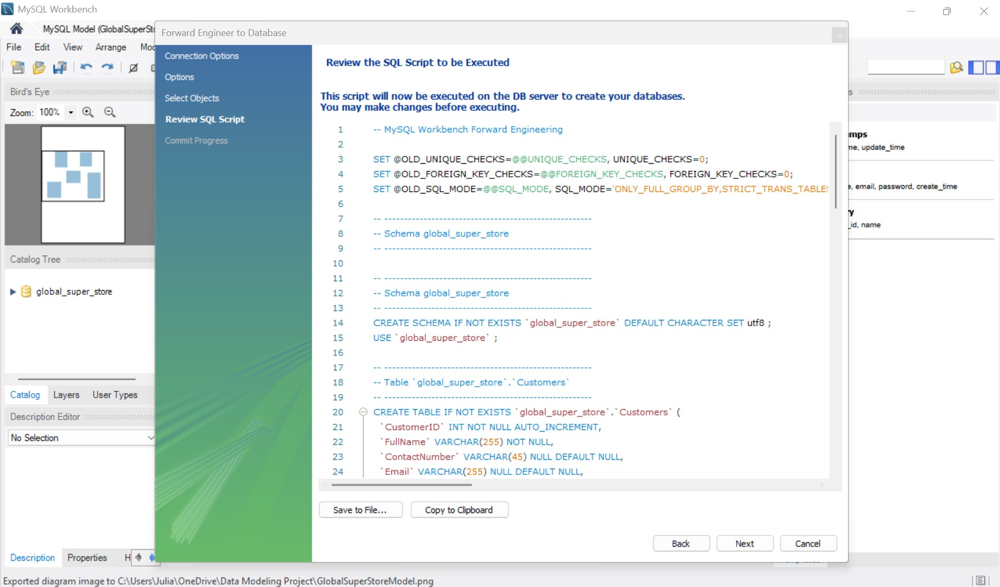
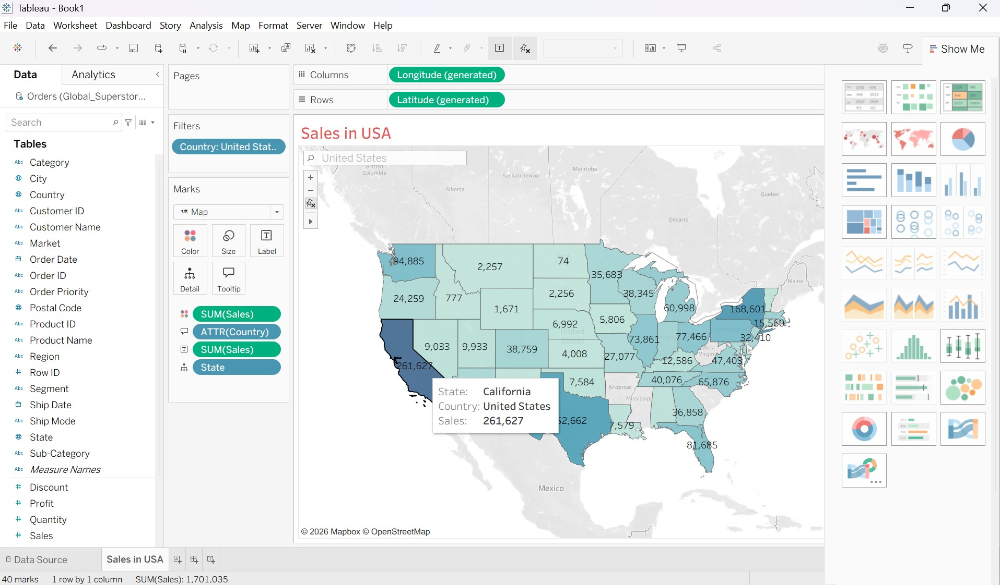
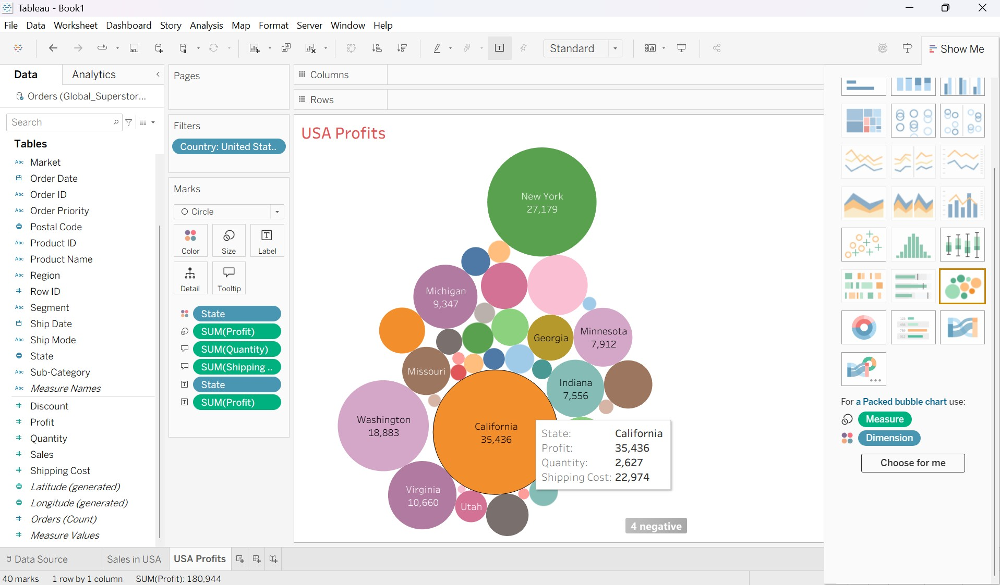
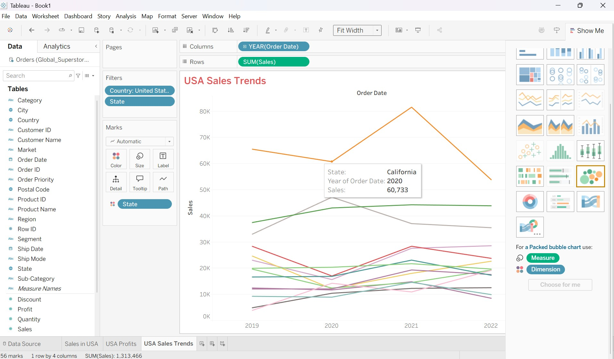

# Global Superstore Data Model

A MySQL data modeling and business intelligence project featuring a normalized 3NF OLTP database, a dimensional star schema for analytics, and an interactive Tableau dashboard analyzing USA sales and profitability.

> **Data Note:** Because the original Global Superstore file was unavailable, this project uses a synthetic dataset matching the original schema (`Orders` sheet, 5,100 rows, 2019–2022). All figures are illustrative rather than actual company performance, and certain US states have zero recorded sales as a result.

## Project Overview

**End-to-End Workflow:** Excel Dataset $\rightarrow$ Normalized OLTP Database $\rightarrow$ Dimensional Star Schema $\rightarrow$ Tableau Dashboard

1. **OLTP Modeling & Deployment:** Designed a physical Entity-Relationship Diagram (ERD) in MySQL Workbench and forward-engineered it to a live MySQL Server instance (`127.0.0.1:3306`).
2. **Reporting View:** Created an `OrderSummary` SQL view joining all five normalized tables into a unified reporting layer.
3. **Data Warehouse Design:** Modeled a star schema (`global_super_store_dw`) tailored for marketing analysis of USA sales by product, location, and time.
4. **BI Visualization:** Built a three-view interactive Tableau dashboard on the Orders dataset with cross-filtering across all visuals.

## Repository Structure

```text
├── data/       # Synthetic Excel dataset (Global_Superstore_Orders.xlsx)
├── sql/        # MySQL DDL scripts and view definitions
├── models/     # MySQL Workbench model files (.mwb)
├── tableau/    # Tableau workbook (.twb)
└── docs/
    └── images/ # ER diagrams, Workbench deployment screenshots, and dashboard visuals
```

## Data Models

### 1. OLTP Schema (Third Normal Form)

The transactional schema (`global_super_store`) is normalized to 3NF across five tables, each with a single primary key (`INT`):

* **`Customers`** (`CustomerID`, `FullName`, `ContactNumber`, `Email`)
* **`Products`** (`ProductID`, `ProductName`, `AmountInStock`, `Price`, `Category`, `Subcategory`)
* **`DeliveryAddress`** (`AddressID`, `Street`, `PostCode`, `City`, `State`, `Country`)
* **`Shipping`** (`ShipID`, `ShipDate`, `ShipMode`, `ShipCost`, `AddressID`) — links to `DeliveryAddress`
* **`Orders`** (`OrderID`, `OrderDate`, `CustomerID`, `ProductID`, `ShipID`, `Quantity`, `Sales`, `Discount`, `Profit`, `TotalCost`, `OrderPriority`) — links to `Customers`, `Products`, and `Shipping`

**Normalization Applied:**
* **1NF:** Every column stores a single atomic value.
* **2NF:** Every non-key attribute depends on the entire primary key.
* **3NF:** Transitive dependencies are eliminated (e.g., customer contact details are stored once in `Customers` and address details once in `DeliveryAddress` rather than repeated on every order).


### 2. Star Schema (`global_super_store_dw`)

To support analytical queries by product, geography, and time, the dimensional model centers on a central fact table linked via foreign keys to three dimension tables:

* **`FactSales`**: `Price`, `Cost`, `Shipping`, `Quantity` (plus dimension foreign keys)

| Dimension Table | Columns |
| :--- | :--- |
| **`DimProducts`** | `ProductName`, `Category`, `Subcategory`, `Description` |
| **`DimLocation`** | `Continent`, `Country`, `State`, `City` |
| **`DimTime`** | `FullDate`, `Year`, `Quarter`, `Month`, `Day` |

> **Design Decisions:** A `State` attribute was explicitly included in `DimLocation` to enable state-level US sales rollups. A customer dimension was intentionally omitted because the marketing analysis focuses strictly on product, place, and time performance.


## MySQL Implementation & Verification

The physical EER diagram in MySQL Workbench was forward-engineered and deployed to MySQL Server:

| Connection Setup | Forward Engineering Script | Successful Deployment |
| :---: | :---: | :---: |
|  |  |  |

After deploying the schema, the `OrderSummary` view was created to denormalize `Orders`, `Customers`, `Products`, `Shipping`, and `DeliveryAddress` into a single queryable reporting interface:


## How to Run

1. **Create the OLTP Schema:** Open and execute `sql/01_create_oltp_schema.sql` in MySQL Workbench to create the `global_super_store` database and tables. *(Alternatively, open the `.mwb` file in `models/` via **File > Open Model** and run **Database > Forward Engineer**.)*
2. **Load Sample Data & Create View:** Insert sample records into the OLTP tables, then execute `sql/03_create_oltp_view.sql` to create and test the `OrderSummary` view.
3. **Create the Star Schema:** Execute `sql/04_create_star_schema.sql` to deploy the `global_super_store_dw` dimensional tables.
4. **Open the Tableau Workbook:** Open `tableau/GlobalSuperStoreAnalysis.twb` in Tableau Desktop. When prompted for the data source, relink it to `data/Global_Superstore_Orders.xlsx`.

## Tableau Dashboard: USA Sales and Profits

All three views are configured with interactive filter actions—selecting any state in one chart dynamically filters the remaining two views.

| View | Visual Type | Description & Metrics |
| :--- | :--- | :--- |
| **Sales in USA** | Filled Map | US states colored and labeled by total `Sales`. Tooltips display `State`, `Country`, and `Sales`. |
| **USA Profits** | Packed Bubbles | Bubble size encodes `Profit` per state. Tooltips add `Quantity` and `Shipping Cost`. Four states are highlighted as negative due to net losses. |
| **USA Sales Trends** | Line Chart | Annual `Sales` trajectory (2019–2022) by state, filtered to states with cumulative sales of at least `$40,000`. |


### Filtered View: California

Clicking **California** cross-filters the map, profit bubble, and 2019–2022 trend line to isolate state-level performance:


### Individual Views

| Sales in USA (Map) | USA Profits (Packed Bubbles) | USA Sales Trends (Line Chart) |
| :---: | :---: | :---: |
|  |  |  |

## Limitations & Future Improvements

* **Synthetic Data:** Metrics and state-level distributions are illustrative and do not reflect real-world retail performance.
* **Direct Excel Connection:** Tableau currently connects directly to the `Orders` Excel sheet rather than querying the MySQL `global_super_store_dw` star schema.
* **Fact Table Metrics:** `FactSales` captures base measures (`Price`, `Cost`, `Shipping`, `Quantity`) and does not yet store derived or transactional fields (`Sales`, `Discount`, `Profit`), which currently reside only in the OLTP `Orders` table and Excel source.
* **ETL Pipeline:** Only sample rows were loaded into MySQL to verify the `OrderSummary` view; building an automated Python/SQL ETL pipeline to load all 5,100 rows from Excel into OLTP and populate the star schema is a natural next step.
