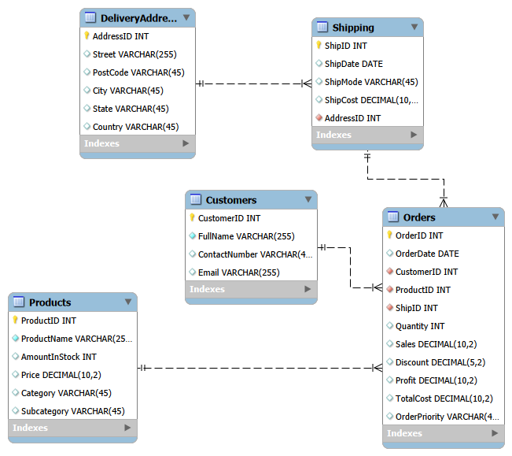
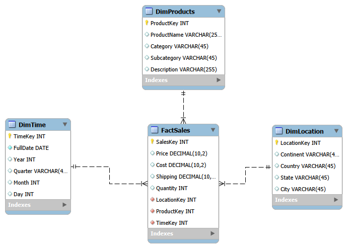
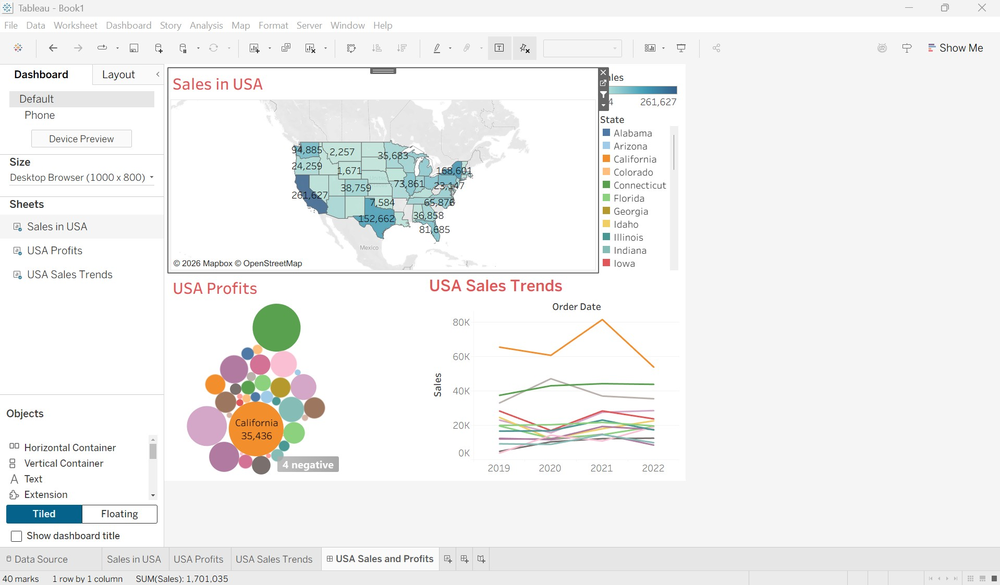
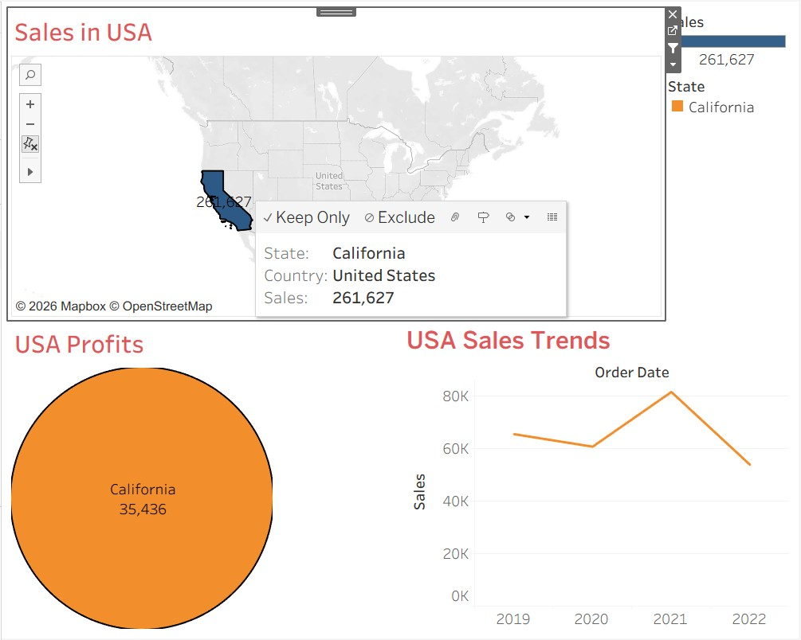

# Global Superstore Data Model

A MySQL data modeling project: a normalized OLTP database, a star schema
for analysis, and a Tableau dashboard of USA sales and profits.

> **Data note:** The original Global Superstore file was not available, so
> this project uses a synthetic dataset with the same columns (Orders sheet,
> 5,100 rows, 2019-2022). All figures are illustrative, not real company
> data. Some states have no sales for the same reason.

## Project Overview

Workflow: Excel dataset -> normalized OLTP database -> star schema -> Tableau dashboard.

1. Designed a physical ER diagram in MySQL Workbench and deployed it to MySQL Server.
2. Created an `OrderSummary` view joining all five tables.
3. Designed a star schema for the marketing team's USA sales analysis.
4. Built a three-view Tableau dashboard on the Orders data.

## Repository Structure

    data/      Excel dataset (synthetic)
    sql/       MySQL scripts
    models/    MySQL Workbench models (.mwb)
    tableau/   Tableau workbook (.twb)
    docs/      Diagrams and dashboard screenshots

## Data Models

### 1. OLTP schema (third normal form)

Five tables: Customers, Products, DeliveryAddress, Shipping and Orders.
Each table has a single primary key. Orders links to Customers, Products
and Shipping, and Shipping links to DeliveryAddress.

- **1NF:** every column holds one atomic value.
- **2NF:** every non-key column depends on the whole key.
- **3NF:** no non-key column depends on another non-key column.

For example, customer details are stored once in Customers instead of
being repeated on every order.

### 2. Star schema

FactSales (price, cost, shipping, quantity) is linked by foreign keys to
three dimensions:

| Table | Columns |
|-------|---------|
| DimProducts | product name, category, subcategory, description |
| DimLocation | continent, country, state, city |
| DimTime | full date, year, quarter, month, day |

A State column was added to DimLocation so sales can be broken down by
US state. There is no customer dimension because the analysis is by
product, place and time.

## How to Run

1. Run `sql/01_create_oltp_schema.sql` in MySQL Workbench to create the `global_super_store` schema.
2. Run `sql/04_create_star_schema.sql` to create the `global_super_store_dw` schema.
3. Open `tableau/GlobalSuperStoreAnalysis.twb` in Tableau. When it cannot find the data source, relink it to `data/Global_Superstore_Orders.xlsx`.

The Workbench models are in `models/` and can be opened with File > Open Model.

## Tableau Dashboard: USA Sales and Profits

| View | Description |
|------|-------------|
| Sales in USA (map) | Map of US states colored and labeled by Sales. The tooltip shows state, country and sales. |
| USA Profits (packed bubbles) | Bubble size shows Profit per state. The tooltip adds Quantity and Shipping Cost. Four states show as "negative" because they had a loss. |
| USA Sales Trends (line chart) | Yearly Sales by state, 2019-2022, limited to states with total sales of at least 40,000. |

All three views are set to filter the others, so clicking a state in any
view updates the other two.

Filtered to California:

## Limitations

- The data is synthetic, so the results are illustrative only.
- Tableau reads the Orders sheet directly, not the star schema.
- FactSales has no Sales, Discount or Profit columns. These are available only in the Excel source.
- A few sample rows were entered into the MySQL tables to test the view.
